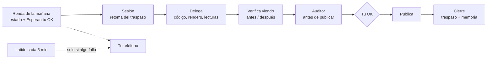

# Jarvis

Un agente personal que trabaja como un equipo: un orquestador que decide y revisa, subagentes que programan, ejecutan y leen, un auditor que cuida la seguridad, un cerebro en Markdown que no olvida y rutinas que te avisan lo importante sin hacer ruido.

Esta repo es la **forma de trabajar** detrás del Jarvis que uso todos los días, escrita para que la copies: la documentación de cómo opera, las plantillas para armarlo en tu compu y ejemplos con datos inventados. Además trae una app web + bot de Telegram para capturar tu agenda en lenguaje natural.

No trae mis claves ni mis datos. Trae los flujos.

---

## Un día con el agente



- **Al empezar el día** (a la hora que elijas), la ronda revisa los sistemas. Si todo está bien, una frase. Si no, qué falló. Y te recuerda las decisiones más viejas que esperan tu OK.
- **Empiezas a trabajar.** Le pides algo grande. El agente lee el último traspaso, sabe dónde se quedó y te dice en cuántos pasos va.
- **El trabajo se reparte.** El código largo lo hace el `programador`, el render el `obrero`, las búsquedas el `mensajero`. El orquestador revisa lo que vuelve y te avisa en qué paso va.
- **"Listo" quiere decir que lo vio.** Captura en el navegador, la app en el simulador, fotogramas del video. Y una lista de lo que **no** comprobó.
- **Antes de publicar,** el auditor revisa. Hallazgos con ID y severidad, nunca "es seguro".
- **Publicar, migrar, mandar algo a alguien:** espera tu OK. Lo demás lo decide solo.
- **Al cerrar,** escribe el traspaso de mañana y, si aprendió algo de ti, lo guarda en su memoria.
- **Todo el día,** el latido vigila. Si algo se cae dos vueltas seguidas, te avisa una vez. Al teléfono sólo llega qué pasó y cuántos, nunca el detalle.

Una sesión completa, paso por paso: [`ejemplos/una-sesion-de-trabajo.md`](ejemplos/una-sesion-de-trabajo.md).

---

## El mapa

### La forma de trabajar

| # | Documento | De qué trata |
|---|---|---|
| 1 | [Orquestación y reparto de modelos](docs/01-orquestacion.md) | Quién decide, quién ejecuta, cuándo no delegar y el hook que lo obliga |
| 2 | [Cerebro local y memoria](docs/02-cerebro-y-memoria.md) | Notas en Markdown, fichas, traspasos, "Esperan tu OK" y memoria de un hecho por archivo |
| 3 | [Forma de operar](docs/03-forma-de-operar.md) | Avisos de vida, reportes directos, verificar viendo, credenciales y qué pide OK |
| 4 | [Flujo de construcción](docs/04-flujo-de-construccion.md) | Rama por función, banderas, antes y después, integración y "sin comprobar" |
| 5 | [Seguridad](docs/05-seguridad.md) | El auditor defensivo, hallazgos con ID, riesgo aceptado y qué sale de tu compu |
| 6 | [Rutinas](docs/06-rutinas.md) | Ronda de la mañana, latido, avisos con prioridades y aprobaciones |

### Plantillas para copiar

| Carpeta | Qué trae |
|---|---|
| [`plantillas/claude/`](plantillas/claude/) | `CLAUDE.md` global, los cuatro subagentes (`programador`, `obrero`, `mensajero`, `auditor`), el hook `solo-orquesta.sh` y cómo registrarlo |
| [`plantillas/cerebro/`](plantillas/cerebro/) | Inicio, "Esperan tu OK", bitácora, decisiones, traspaso y fichas de persona y proyecto |
| [`plantillas/memoria/`](plantillas/memoria/) | El índice y el formato de un hecho |
| [`plantillas/seguridad/`](plantillas/seguridad/) | `SECURITY_AUDIT.md` y `scope.txt` |
| [`plantillas/construccion/`](plantillas/construccion/) | El LEEME de un entregable y la lista "listo para publicar" |
| [`plantillas/rutinas/`](plantillas/rutinas/) | El `launchd` para correr el latido en macOS |

### Ejemplos (todo inventado)

| Carpeta | Qué muestra |
|---|---|
| [`ejemplos/cerebro-demo/`](ejemplos/cerebro-demo/) | Un cerebro lleno: Ana (clienta ficticia), el Proyecto Demo, su traspaso y su lista de OK |
| [`ejemplos/memoria-demo/`](ejemplos/memoria-demo/) | Cuatro hechos de memoria con su porqué |
| [`ejemplos/auditoria-demo/`](ejemplos/auditoria-demo/) | Un registro de auditoría con hallazgos, riesgo aceptado y lo que salió al teléfono |
| [`ejemplos/una-sesion-de-trabajo.md`](ejemplos/una-sesion-de-trabajo.md) | Una sesión de punta a punta con delegación |

### Scripts chicos que funcionan

| Script | Qué hace |
|---|---|
| [`scripts/rutinas/esperan-ok.py`](scripts/rutinas/esperan-ok.py) | Lee "Esperan tu OK" y devuelve lo abierto, lo más viejo primero (texto, JSON o sólo el conteo) |
| [`scripts/rutinas/latido.py`](scripts/rutinas/latido.py) | Chequeos con aviso sin ruido: dos vueltas antes de avisar, un aviso por falla |
| [`plantillas/claude/hooks/solo-orquesta.sh`](plantillas/claude/hooks/solo-orquesta.sh) | Hook de Claude Code que bloquea subagentes con el modelo caro |

Sólo usan la biblioteca estándar de Python, `bash` y `jq`.

### La app incluida

Una app web (Next.js + Supabase) y un bot de Telegram: le escribes "comida con Ana el viernes a las 2" y lo pone en tu Google Calendar; te manda el resumen de la mañana y los recordatorios. Guía completa: [`docs/instalar-la-app.md`](docs/instalar-la-app.md).

---

## Inicio rápido

Elige por dónde empezar. Cada paso sirve solo.

**1. El reparto de modelos.** Necesitas [Claude Code](https://docs.anthropic.com/en/docs/claude-code) y `jq`.

```bash
git clone https://github.com/botellosantiago-bot/jarvis-ia.git
cd jarvis-ia
mkdir -p ~/.claude/agents ~/.claude/hooks
cp plantillas/claude/agents/*.md ~/.claude/agents/
cp plantillas/claude/hooks/solo-orquesta.sh ~/.claude/hooks/ && chmod +x ~/.claude/hooks/solo-orquesta.sh
# Revisa y junta con lo que ya tengas (no lo sobrescribas a ciegas):
#   plantillas/claude/CLAUDE.md             -> ~/.claude/CLAUDE.md
#   plantillas/claude/settings.ejemplo.json -> la sección "hooks" de ~/.claude/settings.json
```

Prueba el hook sin instalar nada: `echo '{"tool_input":{"subagent_type":"fork"}}' | bash plantillas/claude/hooks/solo-orquesta.sh`

**2. El cerebro.** Copia `plantillas/cerebro/` a una carpeta `cerebro/` en tu proyecto y ábrela en Obsidian o en tu editor. Mira [`ejemplos/cerebro-demo/`](ejemplos/cerebro-demo/) para ver cómo se ve lleno.

**3. Las rutinas.** Prueba los scripts con los ejemplos:

```bash
python3 scripts/rutinas/esperan-ok.py "ejemplos/cerebro-demo/Esperan tu OK.md" --tope 3
python3 scripts/rutinas/latido.py --config scripts/rutinas/latido.ejemplo.json --prueba
```

Cuando te convenzan, prográmalos con [`plantillas/rutinas/`](plantillas/rutinas/).

**4. La app.** Sigue [`docs/instalar-la-app.md`](docs/instalar-la-app.md).

---

## Qué trae la repo y qué pones tú

| La repo trae | Tú pones |
|---|---|
| La documentación de cómo opera el agente | Tus reglas, ajustadas a cómo trabajas |
| Plantillas vacías y ejemplos inventados | Tus proyectos, tu gente y tus decisiones |
| Los subagentes, el hook y los scripts de rutina | Qué revisa tu latido y a dónde mandan los avisos |
| La app web + bot, con `.env.example` sin valores | Tus claves, en tu `.env.local` (nunca se sube a git) |
| El formato del registro de seguridad | Tu `scope.txt` y tus hallazgos, que no se publican |

**Las claves nunca van en la repo.** Todo lo secreto vive en `.env.local` (ignorado por git) o en las variables de tu proveedor. [`.env.example`](.env.example) dice qué va en cada una y de dónde sacarla, sin un solo valor.

---

## Principios, en corto

1. La sesión principal decide; los subagentes ejecutan.
2. Lo que se escribe en el cerebro no se olvida; lo que sólo se dijo en el chat, sí.
3. "Listo" es cuando se vio funcionar. Y siempre se dice qué no se comprobó.
4. Lo irreversible y lo público esperan tu OK. Lo demás, no.
5. Nunca "es seguro": "sin hallazgos hoy en esto que revisé".
6. Al teléfono sólo viaja el evento y el conteo.
7. Nada de prometer tiempos que no se controlan.

---

## Créditos y licencia

Hecho por **Santiago Botello** ([@botellorex.ia](https://www.instagram.com/botellorex.ia/)). Es la versión abierta y limpia de la forma en que trabaja su Jarvis privado.

- **Código, documentación y plantillas:** licencia MIT, ver [`LICENSE`](LICENSE).
- **Audios de `public/voz/`:** tienen sus propias condiciones, ver [`public/voz/LEEME.md`](public/voz/LEEME.md).
- ¿Quieres aportar? Lee [`CONTRIBUTING.md`](CONTRIBUTING.md).
