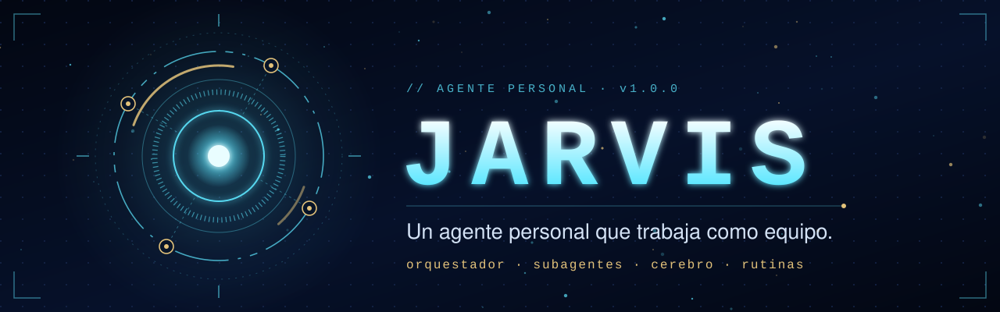
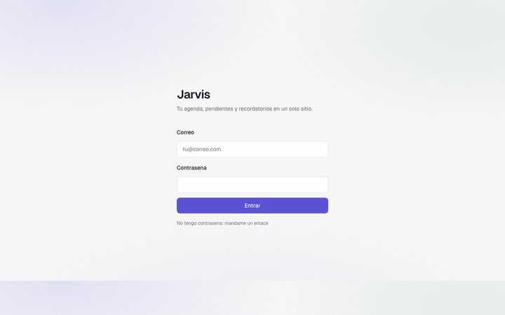
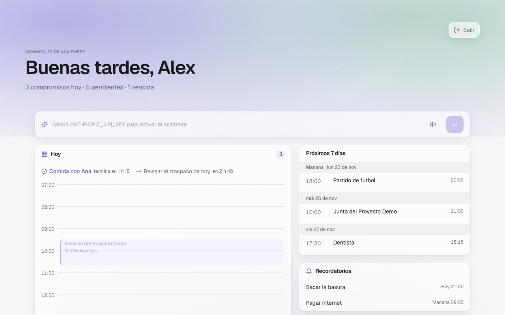
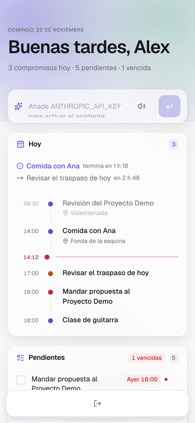
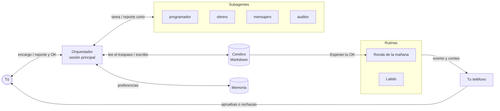
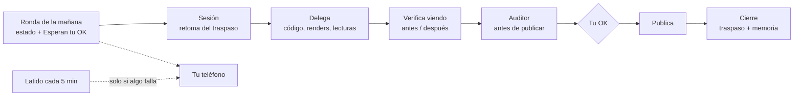

<p align="center">
  
</p>

<p align="center">
  <a href="https://github.com/botellosantiago-bot/jarvis-ia/actions/workflows/ci.yml"></a>
  <a href="LICENSE"></a>
  
  
  
  
  <a href="CONTRIBUTING.md"></a>
</p>

Un agente personal que trabaja como un equipo: un orquestador que decide y revisa, subagentes que programan, ejecutan y leen, un auditor que cuida la seguridad, un cerebro en Markdown que no olvida y rutinas que te avisan lo importante sin hacer ruido.

Esta repo es la **forma de trabajar** detrás del Jarvis que uso todos los días, escrita para que la copies: la documentación de cómo opera, las plantillas para armarlo en tu compu y ejemplos con datos inventados. Además trae una app web + bot de Telegram para capturar tu agenda en lenguaje natural.

No trae mis claves ni mis datos. Trae los flujos.

## Índice

- [Qué hay adentro](#qué-hay-adentro)
- [La app web, en acción](#la-app-web-en-acción)
- [Así se ve el Jarvis privado](#así-se-ve-el-jarvis-privado)
- [Cómo se arma](#cómo-se-arma)
- [Un día con el agente](#un-día-con-el-agente)
- [El mapa](#el-mapa)
- [Inicio rápido](#inicio-rápido)
- [Qué trae la repo y qué pones tú](#qué-trae-la-repo-y-qué-pones-tú)
- [Principios, en corto](#principios-en-corto)
- [Preguntas frecuentes](#preguntas-frecuentes)
- [Hacia dónde va](#hacia-dónde-va)
- [Créditos y licencia](#créditos-y-licencia)

---

## Qué hay adentro

<table>
  <tr>
    <td width="25%" valign="top">
      <h4>🧭 Orquestación</h4>
      La sesión principal decide y revisa; el código, los renders y las lecturas van a subagentes con el modelo que les toca.<br>
      <a href="docs/01-orquestacion.md">Leer</a>
    </td>
    <td width="25%" valign="top">
      <h4>🧠 Cerebro y memoria</h4>
      Notas en Markdown con traspasos, decisiones y una sola lista de "Esperan tu OK". La memoria guarda un hecho por archivo.<br>
      <a href="docs/02-cerebro-y-memoria.md">Leer</a>
    </td>
    <td width="25%" valign="top">
      <h4>📋 Forma de operar</h4>
      Avisos de vida, reportes de tres partes, verificar viendo y pedir OK sólo para lo irreversible.<br>
      <a href="docs/03-forma-de-operar.md">Leer</a>
    </td>
    <td width="25%" valign="top">
      <h4>🛠️ Construcción</h4>
      Rama o worktree por función, banderas de demo, antes y después, y la lista de lo que no se comprobó.<br>
      <a href="docs/04-flujo-de-construccion.md">Leer</a>
    </td>
  </tr>
  <tr>
    <td valign="top">
      <h4>🛡️ Seguridad</h4>
      Un auditor defensivo con alcance escrito, hallazgos con ID y severidad, y nada de "es seguro".<br>
      <a href="docs/05-seguridad.md">Leer</a>
    </td>
    <td valign="top">
      <h4>⏱️ Rutinas</h4>
      La ronda de la mañana y el latido cada 5 minutos: avisa una vez cuando algo falla dos vueltas seguidas.<br>
      <a href="docs/06-rutinas.md">Leer</a>
    </td>
    <td valign="top">
      <h4>💬 App web + bot</h4>
      Next.js, Supabase y Telegram: escribes "comida con Ana el viernes a las 2" y queda en tu Google Calendar.<br>
      <a href="docs/instalar-la-app.md">Instalar</a>
    </td>
    <td valign="top">
      <h4>📦 Plantillas y ejemplos</h4>
      Subagentes, hook, cerebro vacío, registro de seguridad y un cerebro lleno con datos inventados.<br>
      <a href="#el-mapa">Ver el mapa</a>
    </td>
  </tr>
</table>

---

## La app web, en acción

La app que viene en la repo, corriendo en local con datos inventados:

<p align="center">
  
</p>

<table>
  <tr>
    <td width="68%" align="center"><br><sub>El hub: lo que pasa ahora, la rejilla del día, los próximos 7 días y los recordatorios.</sub></td>
    <td width="32%" align="center"><br><sub>El mismo día en el celular.</sub></td>
  </tr>
</table>

¿Recién lo instalaste? Sigue [**Tu primer día con Jarvis**](docs/tu-primer-dia-con-jarvis.md), un recorrido paso a paso de qué escribirle y qué deberías ver.

---

## Así se ve el Jarvis privado

Lo que sigue es del Jarvis privado del autor: la app de iPhone y un monitor conectado a su Mac. **Esta repo no trae el código de la app de iPhone ni el del monitor.** Trae la forma de trabajar con que se construyeron y la app web + bot de arriba. Las imágenes están para que veas hasta dónde puede llegar el método.

**El hub del monitor** es una pantalla vertical conectada a una Mac que siempre está encendida. Cada agente aparece como un holograma de partículas, uno arriba de otro, con su nombre y si está en línea o en espera. Sólo se anima el que está trabajando; los demás se quedan tenues. Va detrás de las ventanas y no estorba.

<table>
  <tr>
    <td width="50%" align="center"><br><sub>El holograma en reposo, en la app de iPhone.</sub></td>
    <td width="50%" align="center"><br><sub>Las partículas siguen al dedo y vuelven a su forma.</sub></td>
  </tr>
  <tr>
    <td align="center"><br><sub>A media deformación: el arrastre las barre en diagonal.</sub></td>
    <td align="center"><br><sub>Dispersas, justo antes de volver a armarse.</sub></td>
  </tr>
  <tr>
    <td colspan="2" align="center"><br><sub>El hub del monitor: Jarvis con su nombre y su estado, sin datos.</sub></td>
  </tr>
</table>

---

## Cómo se arma



Tú hablas sólo con el orquestador. Él reparte, revisa lo que vuelve y escribe en el cerebro. Las rutinas leen ese mismo cerebro y te avisan al teléfono sin el detalle.

---

## Un día con el agente



<details>
<summary><b>El día, paso por paso</b></summary>

- **Al empezar el día** (a la hora que elijas), la ronda revisa los sistemas. Si todo está bien, una frase. Si no, qué falló. Y te recuerda las decisiones más viejas que esperan tu OK.
- **Empiezas a trabajar.** Le pides algo grande. El agente lee el último traspaso, sabe dónde se quedó y te dice en cuántos pasos va.
- **El trabajo se reparte.** El código largo lo hace el `programador`, el render el `obrero`, las búsquedas el `mensajero`. El orquestador revisa lo que vuelve y te avisa en qué paso va.
- **"Listo" quiere decir que lo vio.** Captura en el navegador, la app en el simulador, fotogramas del video. Y una lista de lo que **no** comprobó.
- **Antes de publicar,** el auditor revisa. Hallazgos con ID y severidad, nunca "es seguro".
- **Publicar, migrar, mandar algo a alguien:** espera tu OK. Lo demás lo decide solo.
- **Al cerrar,** escribe el traspaso de mañana y, si aprendió algo de ti, lo guarda en su memoria.
- **Todo el día,** el latido vigila. Si algo se cae dos vueltas seguidas, te avisa una vez. Al teléfono sólo llega qué pasó y cuántos, nunca el detalle.

Una sesión completa, paso por paso: [`ejemplos/una-sesion-de-trabajo.md`](ejemplos/una-sesion-de-trabajo.md).

</details>

---

## El mapa

### La forma de trabajar

| # | Documento | De qué trata |
|---|---|---|
| 1 | [Orquestación y reparto de modelos](docs/01-orquestacion.md) | Quién decide, quién ejecuta, cuándo no delegar y el hook que lo obliga |
| 2 | [Cerebro local y memoria](docs/02-cerebro-y-memoria.md) | Notas en Markdown, fichas, traspasos, "Esperan tu OK" y memoria de un hecho por archivo |
| 3 | [Forma de operar](docs/03-forma-de-operar.md) | Avisos de vida, reportes directos, verificar viendo, credenciales y qué pide OK |
| 4 | [Flujo de construcción](docs/04-flujo-de-construccion.md) | Rama por función, banderas, antes y después, integración y "sin comprobar" |
| 5 | [Seguridad](docs/05-seguridad.md) | El auditor defensivo, hallazgos con ID, riesgo aceptado y qué sale de tu compu |
| 6 | [Rutinas](docs/06-rutinas.md) | Ronda de la mañana, latido, avisos con prioridades y aprobaciones |

### La app incluida

| Documento | Para qué |
|---|---|
| [Instalar la app](docs/instalar-la-app.md) | Supabase, Claude, Google Calendar, Vercel, Telegram y el cron, paso a paso |
| [Tu primer día con Jarvis](docs/tu-primer-dia-con-jarvis.md) | Recorrido guiado después de instalar: qué escribirle y qué deberías ver |
| [Preguntas frecuentes y trampas](docs/faq.md) | Lo que rompe la instalación, con síntoma, causa y arreglo |

<details>
<summary><b>Plantillas para copiar</b></summary>

| Carpeta | Qué trae |
|---|---|
| [`plantillas/claude/`](plantillas/claude/) | `CLAUDE.md` global, los cuatro subagentes (`programador`, `obrero`, `mensajero`, `auditor`), el hook `solo-orquesta.sh` y cómo registrarlo |
| [`plantillas/cerebro/`](plantillas/cerebro/) | Inicio, "Esperan tu OK", bitácora, decisiones, traspaso y fichas de persona y proyecto |
| [`plantillas/memoria/`](plantillas/memoria/) | El índice y el formato de un hecho |
| [`plantillas/seguridad/`](plantillas/seguridad/) | `SECURITY_AUDIT.md` y `scope.txt` |
| [`plantillas/construccion/`](plantillas/construccion/) | El LEEME de un entregable y la lista "listo para publicar" |
| [`plantillas/rutinas/`](plantillas/rutinas/) | El `launchd` para correr el latido en macOS |

</details>

<details>
<summary><b>Ejemplos (todo inventado)</b></summary>

| Carpeta | Qué muestra |
|---|---|
| [`ejemplos/cerebro-demo/`](ejemplos/cerebro-demo/) | Un cerebro lleno: Ana (clienta ficticia), el Proyecto Demo, su traspaso y su lista de OK |
| [`ejemplos/memoria-demo/`](ejemplos/memoria-demo/) | Cuatro hechos de memoria con su porqué |
| [`ejemplos/auditoria-demo/`](ejemplos/auditoria-demo/) | Un registro de auditoría con hallazgos, riesgo aceptado y lo que salió al teléfono |
| [`ejemplos/una-sesion-de-trabajo.md`](ejemplos/una-sesion-de-trabajo.md) | Una sesión de punta a punta con delegación |

</details>

<details>
<summary><b>Scripts chicos que funcionan</b></summary>

| Script | Qué hace |
|---|---|
| [`scripts/rutinas/esperan-ok.py`](scripts/rutinas/esperan-ok.py) | Lee "Esperan tu OK" y devuelve lo abierto, lo más viejo primero (texto, JSON o sólo el conteo) |
| [`scripts/rutinas/latido.py`](scripts/rutinas/latido.py) | Chequeos con aviso sin ruido: dos vueltas antes de avisar, un aviso por falla |
| [`plantillas/claude/hooks/solo-orquesta.sh`](plantillas/claude/hooks/solo-orquesta.sh) | Hook de Claude Code que bloquea subagentes con el modelo caro |

Sólo usan la biblioteca estándar de Python, `bash` y `jq`. La CI los corre en cada cambio.

</details>

---

## Inicio rápido

Elige por dónde empezar. Cada paso sirve solo.

**1. El reparto de modelos.** Necesitas [Claude Code](https://docs.anthropic.com/en/docs/claude-code) y `jq`.

```bash
git clone https://github.com/botellosantiago-bot/jarvis-ia.git
cd jarvis-ia
mkdir -p ~/.claude/agents ~/.claude/hooks
cp plantillas/claude/agents/*.md ~/.claude/agents/
cp plantillas/claude/hooks/solo-orquesta.sh ~/.claude/hooks/ && chmod +x ~/.claude/hooks/solo-orquesta.sh
# Revisa y junta con lo que ya tengas (no lo sobrescribas a ciegas):
#   plantillas/claude/CLAUDE.md             -> ~/.claude/CLAUDE.md
#   plantillas/claude/settings.ejemplo.json -> la sección "hooks" de ~/.claude/settings.json
```

Prueba el hook sin instalar nada: `echo '{"tool_input":{"subagent_type":"fork"}}' | bash plantillas/claude/hooks/solo-orquesta.sh`

**2. El cerebro.** Copia `plantillas/cerebro/` a una carpeta `cerebro/` en tu proyecto y ábrela en Obsidian o en tu editor. Mira [`ejemplos/cerebro-demo/`](ejemplos/cerebro-demo/) para ver cómo se ve lleno.

**3. Las rutinas.** Prueba los scripts con los ejemplos:

```bash
python3 scripts/rutinas/esperan-ok.py "ejemplos/cerebro-demo/Esperan tu OK.md" --tope 3
python3 scripts/rutinas/latido.py --config scripts/rutinas/latido.ejemplo.json --prueba
```

Cuando te convenzan, prográmalos con [`plantillas/rutinas/`](plantillas/rutinas/).

**4. La app.** Sigue [`docs/instalar-la-app.md`](docs/instalar-la-app.md) y luego [Tu primer día con Jarvis](docs/tu-primer-dia-con-jarvis.md).

---

## Qué trae la repo y qué pones tú

| La repo trae | Tú pones |
|---|---|
| La documentación de cómo opera el agente | Tus reglas, ajustadas a cómo trabajas |
| Plantillas vacías y ejemplos inventados | Tus proyectos, tu gente y tus decisiones |
| Los subagentes, el hook y los scripts de rutina | Qué revisa tu latido y a dónde mandan los avisos |
| La app web + bot, con `.env.example` sin valores | Tus claves, en tu `.env.local` (nunca se sube a git) |
| El formato del registro de seguridad | Tu `scope.txt` y tus hallazgos, que no se publican |
| Una CI que corre lint, tipos, pruebas y build sin secretos | Tu despliegue en Vercel y Supabase |

**Las claves nunca van en la repo.** Todo lo secreto vive en `.env.local` (ignorado por git) o en las variables de tu proveedor. [`.env.example`](.env.example) dice qué va en cada una y de dónde sacarla, sin un solo valor.

---

## Principios, en corto

1. La sesión principal decide; los subagentes ejecutan.
2. Lo que se escribe en el cerebro no se olvida; lo que sólo se dijo en el chat, sí.
3. "Listo" es cuando se vio funcionar. Y siempre se dice qué no se comprobó.
4. Lo irreversible y lo público esperan tu OK. Lo demás, no.
5. Nunca "es seguro": "sin hallazgos hoy en esto que revisé".
6. Al teléfono sólo viaja el evento y el conteo.
7. Nada de prometer tiempos que no se controlan.

---

## Preguntas frecuentes

Las trampas de instalación, cada una con síntoma, causa y arreglo, están en [`docs/faq.md`](docs/faq.md). Las que más pegan:

| Lo que ves | Lo que suele ser |
|---|---|
| El enlace del correo abre `localhost` o te regresa al login | *Site URL* y *Redirect URLs* de Supabase Auth sin tu dominio |
| La barra de captura se queda pensando y falla | El agente encadenó muchas vueltas y la función llegó a su `maxDuration` de 60 s |
| El bot de Telegram no contesta | Webhook sin registrar o `TELEGRAM_WEBHOOK_SECRET` distinto en Vercel |
| Un recordatorio llega hasta el día siguiente | El cron del plan Hobby corre una vez al día; falta `pg_cron` |
| Cambié una variable y no pasa nada | Falta redesplegar en Vercel |

<details>
<summary><b>¿Necesito la app para usar la forma de trabajar?</b></summary>

No. La documentación, las plantillas y los scripts funcionan solos con Claude Code. La app es aparte, para capturar agenda desde la web y Telegram.

</details>

<details>
<summary><b>¿Viene el código de la app de iPhone o del monitor?</b></summary>

No. Son del Jarvis privado del autor y aparecen en [la galería](#así-se-ve-el-jarvis-privado) sólo como referencia.

</details>

<details>
<summary><b>¿Funciona fuera de macOS?</b></summary>

Los documentos, las plantillas y los scripts de rutina sí: piden Python 3, `bash` y `jq`. Lo único de macOS es la plantilla de `launchd` y lo que está en `scripts/mac/`; en Linux usa `cron` o `systemd` para las rutinas.

</details>

<details>
<summary><b>¿Cuánto cuesta?</b></summary>

La repo es gratis (MIT). Supabase, Vercel, Google Cloud y Telegram tienen plan gratis. Claude se paga por uso: pon un límite mensual en la consola de Anthropic. El detalle está en [Antes de empezar](docs/instalar-la-app.md#antes-de-empezar).

</details>

<details>
<summary><b>Encontré un hueco de seguridad. ¿Dónde lo reporto?</b></summary>

En privado, nunca en un issue público. Lee [`SECURITY.md`](SECURITY.md).

</details>

---

## Hacia dónde va

Lo que sigue para esta repo, sin fechas: [`ROADMAP.md`](ROADMAP.md). Lo que ya cambió: [`CHANGELOG.md`](CHANGELOG.md).

---

## Créditos y licencia

Hecho por **Santiago Botello** ([@botellorex.ia](https://www.instagram.com/botellorex.ia/)). Es la versión abierta y limpia de la forma en que trabaja su Jarvis privado.

- **Código, documentación y plantillas:** licencia MIT, ver [`LICENSE`](LICENSE).
- **Audios de `public/voz/`:** tienen sus propias condiciones, ver [`public/voz/LEEME.md`](public/voz/LEEME.md).
- ¿Quieres aportar? Lee [`CONTRIBUTING.md`](CONTRIBUTING.md).
