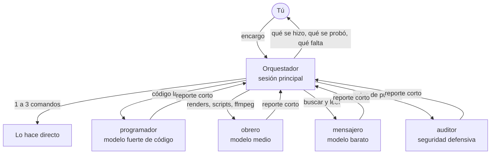

# 1. Orquestación y reparto de modelos

La sesión principal no es la que hace el trabajo pesado. Es la que **decide, delega y revisa**. El código largo, los renders, las lecturas y las auditorías los hacen subagentes, cada uno con el modelo que le toca. Así el modelo más caro se gasta en pensar y no en leer logs.

## La idea en una imagen



## Quién hace qué

| Rol | Modelo | Para qué | Qué devuelve |
|---|---|---|---|
| **Orquestador** (la sesión) | El más capaz que tengas | Entender el encargo, partirlo, revisar lo que vuelve y hablar contigo | Decisiones y el reporte final |
| **programador** | Fuerte en código (p. ej. Opus) | Escribir, arreglar o refactorizar código que lleve más de unos cuantos comandos | `archivo:línea` de lo que cambió, cómo lo probó, qué falta |
| **obrero** | Medio (p. ej. Sonnet) | Tareas claras y largas: renders, conversiones, mover archivos, correr scripts y revisar su salida | Resultado en pocas líneas, rutas generadas, errores textuales |
| **mensajero** | Barato (p. ej. Haiku) | Buscar un archivo, leer notas, resumir un documento o una página. Sólo lectura | La respuesta concreta y la ruta. Nunca el documento completo |
| **auditor** | Fuerte | Revisión de seguridad defensiva antes de publicar | Hallazgos con ID, severidad y estado ([ver seguridad](05-seguridad.md)) |

Las definiciones listas para copiar están en [`plantillas/claude/agents/`](../plantillas/claude/agents/).

## Cuándo NO delegar

Delegar cuesta: el subagente arranca sin contexto y tú sólo ves su resumen. No lo hagas cuando:

- **La tarea son 1 a 3 comandos.** Un `git status`, leer un archivo que ya sabes dónde está, mover una carpeta. Hazlo directo.
- **Necesitas ver el detalle para decidir.** Si el resumen no te basta, delegar sólo agrega una vuelta.
- **Ya delegaste lo mismo.** No lo repitas en paralelo "por si acaso". Espera el resultado.

## Salidas largas fuera del hilo principal

El hilo principal es caro y se llena rápido. Reglas:

- Logs, JSON, páginas web y resultados de búsqueda **nunca** se pegan completos en la sesión principal. Se filtran (`head`, `grep`, `jq`) o se le dan a un subagente que devuelva la conclusión.
- En el navegador, primero texto con límite de caracteres. Capturas sólo cuando lo que importa es cómo se ve.
- Un subagente no "vuelca" archivos en su reporte. Cita `archivo:línea` y ya.

## Cómo escribir un buen encargo

El subagente sólo sabe lo que le pongas. Un encargo bueno trae:

1. **Meta** en una línea: qué tiene que quedar hecho.
2. **Dónde**: rutas exactas de los archivos o carpetas.
3. **Qué ya descartaste**, para que no repita tu camino.
4. **Límites**: qué no tocar, si puede hacer commit, si puede instalar.
5. **Cómo se ve "listo"**: la prueba que tiene que pasar.

Ejemplo:

> Meta: que el resumen de la mañana incluya los pendientes vencidos. Archivo: `lib/telegram/messages.ts`, función `briefingMessage`. Ya revisé que la consulta trae `due_at`; falta pintarlos. No toques el esquema. Listo = `npm test` pasa y `scripts/test-agent.ts "brief"` muestra la sección "Vencidos". Sin commit.

## El hook que obliga a orquestar

Las buenas intenciones se olvidan a media sesión. Por eso hay un hook de Claude Code que **bloquea** los subagentes que romperían el reparto:

- Un subagente pedido con el modelo caro del orquestador.
- Un `fork` (hereda el modelo de la sesión).
- Un agente genérico sin un modelo barato explícito.

El script está en [`plantillas/claude/hooks/solo-orquesta.sh`](../plantillas/claude/hooks/solo-orquesta.sh) y cómo registrarlo en [`plantillas/claude/settings.ejemplo.json`](../plantillas/claude/settings.ejemplo.json). Cuando bloquea, le dice al orquestador a quién usar en su lugar.

Pruébalo sin instalar nada:

```bash
echo '{"tool_input":{"subagent_type":"fork"}}' | bash plantillas/claude/hooks/solo-orquesta.sh; echo "salida=$?"
# salida=2 y el mensaje con el reparto
echo '{"tool_input":{"subagent_type":"programador"}}' | bash plantillas/claude/hooks/solo-orquesta.sh; echo "salida=$?"
# salida=0
```

Necesita `jq`.

## El CLAUDE.md global

Las reglas de reparto viven en `~/.claude/CLAUDE.md`, que Claude Code lee en todos tus proyectos. Plantilla: [`plantillas/claude/CLAUDE.md`](../plantillas/claude/CLAUDE.md). Es corto a propósito: lo que no cabe en una pantalla, nadie lo sigue.

## Señales de que el reparto se rompió

- La sesión principal tiene 20 lecturas de archivos seguidas: eso era trabajo del mensajero.
- Un render de media hora corre en el modelo caro.
- Se te acaba el límite de uso a medio día.
- Lanzaste varios agentes en paralelo y ninguno terminó: prometiste más de lo que el límite aguantaba.
