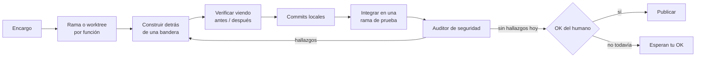

# 4. Flujo de construcción

Cómo se construye una función nueva sin romper lo que ya funciona y sin publicar algo que nadie revisó.



## 1. Una rama (o worktree) por función

- Cada función nueva va en su rama: `feat/resumen-vencidos`, `arreglo/recordatorio-doble`.
- Si vas a trabajar varias funciones en paralelo (o varios agentes a la vez), usa **worktrees**: una carpeta por rama, sin pisarse.

  ```bash
  git worktree add ../mi-app-resumen -b feat/resumen-vencidos
  ```

- La rama principal sólo recibe lo que ya pasó por todo el flujo.

## 2. Banderas de demo

Lo nuevo entra apagado. Una bandera (variable de entorno o constante) lo prende sólo donde quieres verlo:

```ts
// lib/banderas.ts
export const banderas = {
  resumenVencidos: process.env.NEXT_PUBLIC_BANDERA_RESUMEN_VENCIDOS === "1",
};
```

Así puedes integrar código a medio terminar sin que lo vea nadie, y grabar una demo con la función prendida sin publicarla.

## 3. Entregables con antes y después

Cada función deja evidencia de que funciona, en una carpeta de entregables fuera del código:

```
entregables/resumen-vencidos/
├── LEEME.md            qué es, cómo se probó, qué NO se comprobó
├── antes.png
└── despues.png         (o un video corto de la demo)
```

La plantilla del `LEEME.md` está en [`plantillas/construccion/entregable.md`](../plantillas/construccion/entregable.md). Los videos pesados no se suben a git: se dejan en la carpeta y se ignoran.

## 4. Commits locales

- El agente hace commits **locales** con mensajes que dicen qué cambia y por qué.
- **No hace push** sin OK, y menos a una repo pública.
- Commits chicos: una función por commit (o unos pocos), para poder regresar uno sin perder lo demás.

## 5. Integración

Antes de publicar, las ramas listas se juntan en una rama de integración (`integracion/semana-12`) y se prueba **todo junto**: lint, typecheck, build, pruebas y verificación viendo. Dos funciones que funcionan solas pueden romperse juntas.

## 6. Revisión de seguridad ANTES de publicar

El [auditor](05-seguridad.md) revisa la rama de integración, no producción. Lo que encuentra se corrige o se marca como riesgo aceptado, con bitácora. Nada se publica con hallazgos altos abiertos.

## 7. La lista de "sin comprobar"

Antes de pedir el OK para publicar, el agente entrega:

```markdown
## Listo para publicar: resumen con vencidos

**Comprobado**
- [x] lint, typecheck y build en verde
- [x] Visto en escritorio y a 390 px (capturas en entregables/)
- [x] Auditor: sin hallazgos hoy en los archivos tocados

**Sin comprobar**
- [ ] Con más de 50 pendientes vencidos (no hay datos así)
- [ ] El mensaje real en Telegram (necesita el bot de producción)

**Al publicar**
- Bandera: NEXT_PUBLIC_BANDERA_RESUMEN_VENCIDOS=1
- Sin migraciones
```

Plantilla en [`plantillas/construccion/listo-para-publicar.md`](../plantillas/construccion/listo-para-publicar.md).

## 8. Publicar

Sólo con el OK explícito. Después de publicar, se verifica **en producción** viendo, no sólo que el deploy terminó. Y se anota en la bitácora.

## Cosas que aprendimos a la mala

- **Una migración de base de datos es irreversible en la práctica.** Siempre pide OK, y córrela primero en una base de prueba.
- **"Ya compiló" no es "ya funciona".** Muchas fallas sólo se ven en el dispositivo real.
- **Si un control de permisos bloquea algo, no se rodea.** Se reporta y se espera.
- **Trabajo en paralelo sin worktrees = archivos pisados.** Una carpeta por agente.
