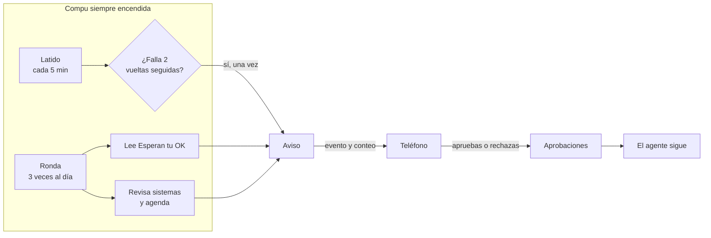
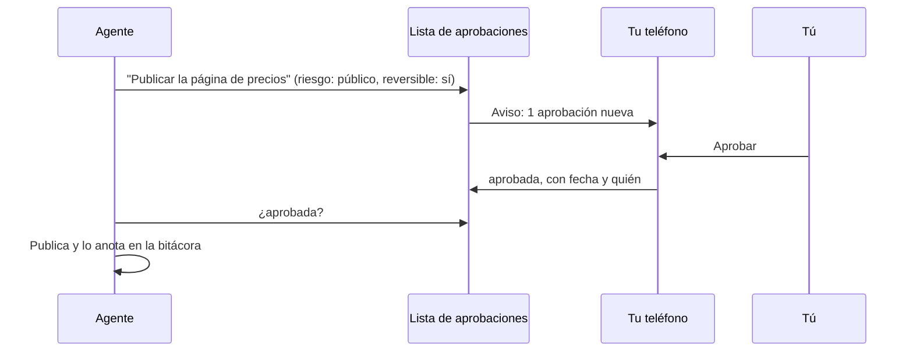

# 6. Rutinas: la ronda, el latido y los avisos

Un agente que sólo trabaja cuando le escribes es un chat. Uno que revisa solo, te avisa lo importante y se calla lo demás es un asistente. Estas rutinas corren en una compu siempre encendida (una Mac mini, una Raspberry, un servidor en casa) con `launchd`, `cron` o `systemd`.



## La ronda

Corre a horas fijas (por ejemplo 9, 14 y 19 h) y te da un estado ejecutivo:

- **Todo bien:** una sola frase. No gasta modelo: sale de un banco de frases ya escritas.
- **Algo falla:** la frase y el detalle de qué falló.
- **La de la mañana** suma las decisiones de "Esperan tu OK" sin marcar, las más viejas primero, con un tope (5) para no abrumar.
- **Citas:** te avisa una hora antes de cada evento del calendario.

El script [`scripts/rutinas/esperan-ok.py`](../scripts/rutinas/esperan-ok.py) es la pieza que lee la lista. Pruébalo con el ejemplo:

```bash
python3 scripts/rutinas/esperan-ok.py ejemplos/cerebro-demo/"Esperan tu OK.md" --tope 5
```

## El latido

Cada 5 minutos revisa que lo básico siga vivo: procesos, servicios, espacio en disco, colas sin trabajos atorados. Tres reglas:

1. **Dos vueltas seguidas antes de avisar.** Un parpadeo no es una falla.
2. **Un solo aviso por falla.** Mientras siga igual, no repite. Cuando se recupera, avisa una vez.
3. **El latido no arregla.** Sólo avisa. Reiniciar cosas es trabajo de otro proceso (o tuyo), para que un chequeo con un error no tumbe lo que sí funcionaba.

Script genérico: [`scripts/rutinas/latido.py`](../scripts/rutinas/latido.py). Le dices qué revisar en un JSON y él lleva el estado:

```bash
python3 scripts/rutinas/latido.py --config scripts/rutinas/latido.ejemplo.json --prueba
```

Para programarlo, la plantilla de `launchd` está en [`plantillas/rutinas/com.ejemplo.latido.plist`](../plantillas/rutinas/com.ejemplo.latido.plist).

## Avisos con prioridades

No todo merece sonar. Tres niveles:

| Prioridad | Ejemplos | Cómo llega |
|---|---|---|
| **Alta** | Un servicio caído, un hallazgo de seguridad alto, una cita en una hora | Suena siempre, también en horas de silencio si así lo decides |
| **Normal** | El reporte de la ronda, un entregable listo, algo nuevo en "Esperan tu OK" | Notificación normal, respeta horas de silencio |
| **Baja** | Recordar limpiar el contexto de una sesión larga, una app nueva instalada | Sólo si estás usando la compu; si no, se descarta |

Reglas que evitan que los avisos se vuelvan ruido:

- **Horas de silencio** (por ejemplo de 23 a 8). Lo normal y lo bajo esperan.
- **Sólo si estás presente** para lo bajo: hablarle a un cuarto vacío no sirve.
- **Evento y conteo, no detalle**, cuando el aviso sale de tu compu ([ver seguridad](05-seguridad.md#al-teléfono-y-a-la-nube-evento-y-conteo-nunca-detalle)).
- **Si el canal de avisos falla, la rutina sigue.** El aviso es un extra, no una dependencia.

## Aprobaciones: el humano en el circuito

Para lo irreversible, el agente no se detiene a esperarte: deja una **solicitud de aprobación** y sigue con lo demás.



Reglas:

- Cada solicitud dice **qué**, **riesgo** y **si se puede deshacer**.
- Sólo el dueño puede aprobar. Un agente nunca aprueba lo suyo.
- La aprobación vale para **esa** acción, no para las siguientes parecidas.
- Si no hay respuesta, la solicitud se queda en "Esperan tu OK". No hay "aprobado por silencio".

## Higiene de sesiones

Las sesiones largas de un agente se llenan de contexto viejo y se vuelven lentas y caras. Una rutina de baja prioridad puede recordarte, cada pocas horas de uso, que compactes o limpies la sesión, **después** de escribir el traspaso.

## Ponerle personalidad (opcional)

Los avisos se leen mejor con voz propia: un banco de frases por tipo de aviso (todo bien, algo falló, cita próxima) elegidas al azar, para que no suene siempre igual. La app incluida trae frases grabadas en [`public/voz/`](../public/voz/).
