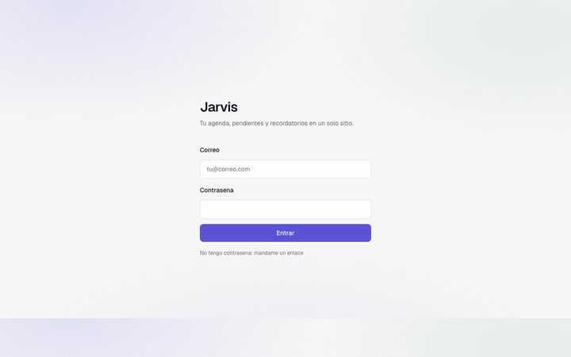
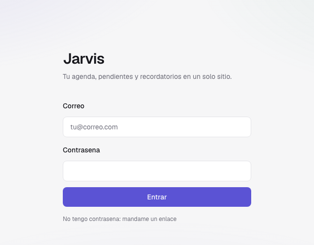
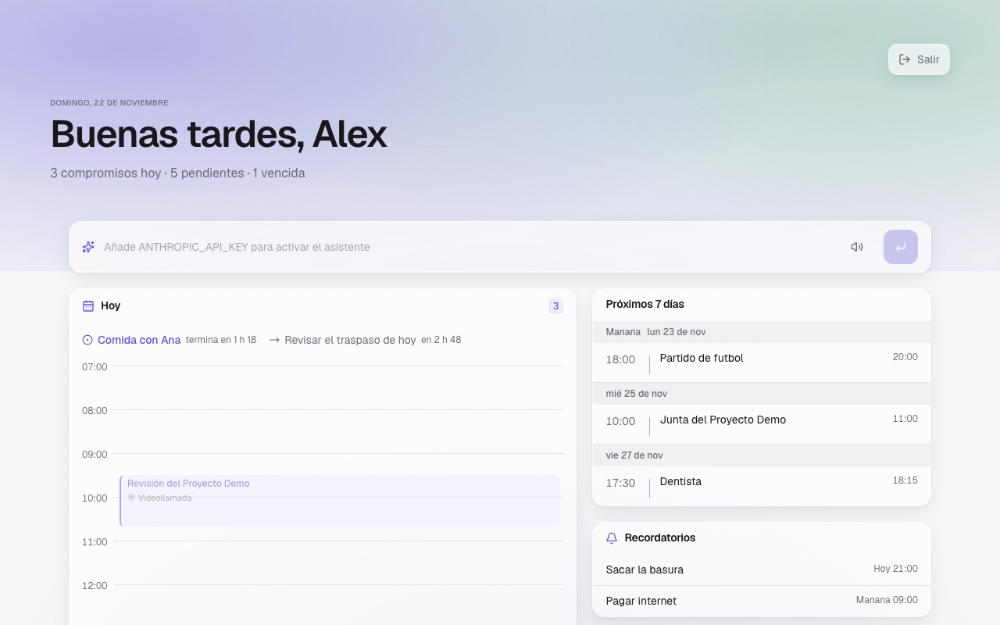
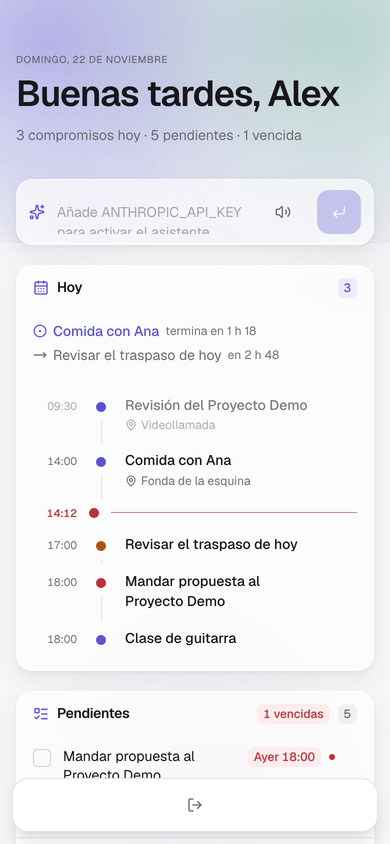

# Tu primer día con Jarvis

Un recorrido para el día en que lo acabas de instalar. Está pensado para seguirse con la app abierta (o para grabarlo en video): cada paso dice qué hacer, qué escribirle a Jarvis y qué deberías ver.

**Antes de empezar** necesitas la app corriendo con Supabase y `ANTHROPIC_API_KEY` ([guía de instalación](instalar-la-app.md), pasos 1 a 4). Google Calendar y Telegram son opcionales: los pasos que los usan lo dicen.

> Las capturas son de la app real con datos inventados ("Alex Demo", "Proyecto Demo", "Ana"). Tu hub va a verse vacío al principio.



---

## Paso 1. Entra

Abre <http://localhost:3000> (o tu dominio de Vercel). Escribe el correo y la contraseña del usuario que creaste en Supabase y pulsa **Entrar**.



**Deberías ver:** el hub, con el saludo según la hora y tu nombre si lo pusiste en `profiles`.

Si te regresa al login, revisa [las trampas de inicio de sesión](faq.md#inicio-de-sesión).

## Paso 2. Conoce el hub



De arriba abajo:

1. **La cabecera:** el día, el saludo y el resumen ("3 compromisos hoy · 5 pendientes · 1 vencida").
2. **La barra de captura:** aquí le escribes todo.
3. **Hoy:** lo que está pasando, lo siguiente y la rejilla del día con eventos, tareas que vencen y tu horario fijo.
4. **Próximos 7 días** y **Recordatorios**, a la derecha.
5. **Pendientes**, abajo.
6. **Conexiones y acceso:** Google Calendar, Telegram y tu contraseña.

## Paso 3. Tu primera tarea

**Escríbele:**

```
llamar al dentista
```

**Deberías ver:** una tarea nueva en **Pendientes**. Jarvis te contesta qué guardó.

## Paso 4. Un evento

**Escríbele:**

```
comida con Ana el viernes a las 2
```

**Deberías ver:** el evento en **Próximos 7 días** (o en **Hoy**, si hoy es viernes). Si ya conectaste Google Calendar (paso 9), también aparece en tu calendario.

Jarvis resuelve "mañana", "el viernes" o "en dos horas" con la zona horaria de tu perfil.

## Paso 5. Un recordatorio

**Escríbele:**

```
recuérdame pagar internet mañana a las 9
```

**Deberías ver:** el aviso en **Recordatorios**. Te llega por Telegram a esa hora si hiciste el paso 10 y tienes el cron cada 5 minutos ([paso 8 de la guía](instalar-la-app.md#8-opcional-recordatorios-a-su-hora-exacta)).

## Paso 6. Tu horario fijo

**Escríbele:**

```
voy al gym lunes, miércoles y viernes de 7 a 8
```

**Deberías ver:** el bloque en la rejilla de **Hoy** los días que toca. Se repite cada semana.

## Paso 7. Algo que debe recordar siempre

**Escríbele:**

```
acuérdate de que no agendo nada antes de las 9
```

**Deberías ver:** que lo confirma. De ahí en adelante lo toma en cuenta al agendar.

## Paso 8. Pregúntale

**Escríbele:**

```
qué tengo hoy
```

y luego:

```
qué traigo pendiente
```

**Deberías ver:** tu agenda y lo que urge; luego tus tareas por prioridad. Al final del día prueba `cerramos día`.

Marca una tarea como hecha con su casilla en **Pendientes**.

## Paso 9. (Opcional) Conecta Google Calendar

En **Conexiones y acceso → Google Calendar**, pulsa **Conectar Google Calendar** y luego **Sincronizar**. Configuración: [paso 5 de la guía](instalar-la-app.md#5-google-calendar).

**Deberías ver:** tus eventos de Google en **Hoy** y **Próximos 7 días**.

## Paso 10. (Opcional) Llévalo en el celular con Telegram

En **Conexiones y acceso → Telegram**, pulsa **Vincular Telegram**, copia el comando `/start …` y mándaselo a tu bot. El código dura 15 minutos. Configuración: [paso 7 de la guía](instalar-la-app.md#7-el-bot-de-telegram).

**Deberías ver:** que el bot te contesta con la ayuda. Desde ahí le escribes igual que en la barra, y cada mañana te llega el resumen del día con botones.

## Paso 11. Ábrelo en el celular

El hub se adapta al teléfono. Desde Telegram, el botón **Abrir Jarvis** lo abre ahí mismo.



---

## Y después: la forma de trabajar

La app es una parte. La otra es cómo trabajas con el agente en tu compu. Si te gustó, sigue con:

1. [El reparto de modelos](01-orquestacion.md): copia los subagentes y el hook.
2. [El cerebro](02-cerebro-y-memoria.md): una carpeta de notas que el agente lee al empezar.
3. [La forma de operar](03-forma-de-operar.md): las reglas de la casa.

¿Algo no salió como dice aquí? Revisa la [FAQ](faq.md) o abre un issue.
